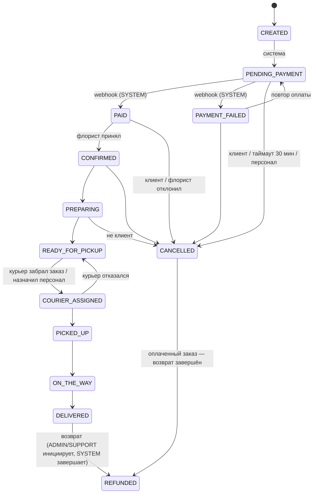

# Архитектура FEYA

## Обзор

```
 Flutter-приложение клиента ─┐                         ┌─ PostgreSQL 16 (Flyway-миграции)
 Веб-консоль персонала (/admin) ─┼─ HTTPS ─ Spring Boot ─┤
 (будущее приложение курьера) ──┘   (модульный монолит)  └─ локальное/объектное хранилище медиа
                                        │
                                        ├─ PaymentProvider (sandbox | реальный шлюз)
                                        ├─ SmsSender (OTP)   ├─ PushSender (FCM)
```

Модульный монолит (один деплой, чёткие границы пакетов `app.feya.*`), без преждевременных микросервисов.

| Модуль | Ответственность |
|---|---|
| `identity` | Вход по телефону (OTP), JWT access + ротируемый refresh, профиль, роли, токены устройств |
| `catalog` | Категории, букеты, размеры (варианты), изображения, избранное, поиск/фильтры, управление товарами |
| `florist` | Точки (флористы), остатки по точке и варианту, подбор точки под заказ, очередь заказов |
| `delivery` | Зоны (центр + радиус), шаблоны слотов, дедлайны, ёмкость, ASAP, стоимость доставки |
| `cart` | Авторитетный расчёт корзины (цены, склад, промокод, доставка, упаковка) |
| `address` | Адреса клиента (несколько, основной, мягкое удаление) |
| `orders` | Заказ, позиции, история статусов, **автомат состояний**, идемпотентное создание, таймаут неоплаты |
| `payments` | Абстракция провайдера, платёж, события, возвраты, проверка подписи webhook |
| `courier` | Профиль/смена курьера, назначение, статусы, геопозиция |
| `tracking` | Трекинг для клиента (polling + SSE), «живая» позиция только по правилам |
| `notifications` | Inbox в приложении + push через `PushSender` |
| `reviews` | Отзывы только по доставленным покупкам, агрегированный рейтинг, модерация |
| `promotions` | Промокоды (процент/фикс, лимиты), баннеры |
| `administration` | REST-консоль: метрики, заказы, справочники, возвраты, аудит |

## Модель данных (основное)

`users`/`user_roles` · `addresses` · `categories` → `products` → `product_variants`, `product_images` ·
`florists` ↔ `florist_zones` ↔ `delivery_zones` → `delivery_slot_templates` · `inventory(florist, variant, quantity)` ·
`orders` → `order_items`, `order_status_history` · `payments` → `payment_events`, `refunds` ·
`couriers` → `courier_locations` · `reviews` · `favorites` · `promo_codes` → `promo_redemptions` · `banners` ·
`notifications` · `audit_events` · `otp_codes`, `refresh_tokens`, `device_tokens`.

Решения:
- **UUID** во всех таблицах. **NUMERIC(12,2)** + явная валюта (`KZT`) для денег, `BigDecimal` в коде.
- **Локализация** — JSONB `{ru,kk,en}` в самих строках каталога (название, описание, состав, подписи размеров).
- Данные заказа (адрес, получатель, названия, цены) **копируются** в заказ: история не меняется задним числом.
- Ограничения БД как последний рубеж: `CHECK` на суммы/количества/статусы, уникальный индекс «не более одного
  PENDING-платежа на заказ», `UNIQUE (provider, event_id)` для webhook, `UNIQUE (product_id, user_id)` для отзывов.
- Версионирование схемы — Flyway. `V1__init.sql` — боевая схема. **Сид** (`R__dev_seed.sql`) лежит в отдельной
  локации `db/seed-dev`, подключается только профилем `dev` и никогда не попадает в production.

## Автомат состояний заказа

Единственный источник истины — `OrderStateMachine` (`orders/`). Любой переход проверяется по таблице
«из → в → кто может» (`CUSTOMER`, `FLORIST`, `COURIER`, `ADMIN`, `SUPPORT`, `SYSTEM`).



Эффекты переходов: `CANCELLED` возвращает остатки и промокод; отмена **оплаченного** заказа автоматически создаёт
возврат (`RefundOnCancelListener`); `DELIVERED` увеличивает счётчик продаж; каждый переход пишет историю и событие
(уведомление клиенту после коммита + обновление SSE-подписчиков).

## Наличие, остатки и слоты

- Остаток хранится **по точке и варианту**. Заказ собирает **одна** точка: `InventoryService.pickFlorist` выбирает
  обслуживающую зону точку с наибольшим приоритетом, у которой есть всё. Каталог показывает только то, что можно
  доставить в выбранную зону; карточка товара показывает наличие по каждому размеру.
- Резервирование — `SELECT … FOR UPDATE` по строкам остатков в транзакции создания заказа; отмена возвращает остаток.
  Тест `ConcurrencyIT` доказывает, что последняя единица товара продаётся один раз.
- Слот = шаблон (время, ёмкость, дедлайн в минутах, наценка, дни недели) × дата. Занятость считается по живым заказам
  (без отменённых); проверка ёмкости идёт под блокировкой строки шаблона. ASAP доступен только в рабочие часы зоны.
- Окно бронирования — до 14 дней вперёд; прошедшие даты и слоты после дедлайна отклоняются сервером (422).

## Платежи

`PaymentProvider` — граница интеграции. Заказ **никогда** не считается оплаченным по ответу клиента:
1. Клиент: `POST /orders/{id}/payments` → запись `PENDING` (один активный платёж на заказ, повторы идемпотентны).
2. Шлюз → `POST /payments/webhook/{provider}`: подпись HMAC по сырому телу, дедупликация, сверка суммы/валюты,
   затем переход заказа `PAID` (или `PAYMENT_FAILED`).
3. `sandbox`-провайдер (только dev) моделирует шлюз: подписывает событие и отправляет его **тем же** обработчиком.
   `ProductionGuard` не даёт запустить production с sandbox, dev-OTP или dev-секретами.

Карточные данные не проходят через FEYA: используется страница/SDK провайдера, клиентские приложения секретов не содержат.

## Безопасность

- Stateless JWT (HS256, секрет из окружения ≥ 32 байт), роли в claim `roles`, проверка на уровне URL и методов.
- OTP хранится как HMAC, 5 попыток, TTL 5 минут, лимит запросов на номер; rate limit по IP на чувствительных путях.
- Ротация refresh-токенов с обнаружением повторного использования; блокировка аккаунта отзывает сессии.
- Ресурсы клиента всегда запрашиваются с `userId` из токена (чужое → 404); флорист ограничен своей точкой.
- Ошибки не раскрывают внутренности; логи не содержат OTP/токенов/номеров карт (номера телефонов маскируются).
- Загрузка изображений: тип по заголовку **и** сигнатуре файла, случайное имя, лимит размера.
- Все изменения персонала пишутся в `audit_events`.

## Время и часовой пояс

В БД и API — UTC (`timestamptz`). Бизнес-логика слотов/ASAP/«сегодня» — в `Asia/Almaty`. Клиент показывает моменты
времени в поясе Алматы независимо от пояса устройства.

## Клиент (Flutter)

Feature-first структура (`mobile/lib/features/*`), Riverpod (Notifier/AsyncValue), GoRouter с `StatefulShellRoute`
(5 вкладок) и redirect для маршрутов, требующих входа, Dio с перехватчиками (bearer, язык, single-flight refresh,
повтор идемпотентных GET). Корзина и выбор оформления — на устройстве (SharedPreferences), цены — только из
`/cart/quote`. Токены — в защищённом хранилище (Keychain/Keystore). Дизайн-токены — `core/theme/tokens.dart`.
Локализация — ARB (`ru` шаблон, `kk`, `en`), генерируется из `tools/i18n_strings.py`.
